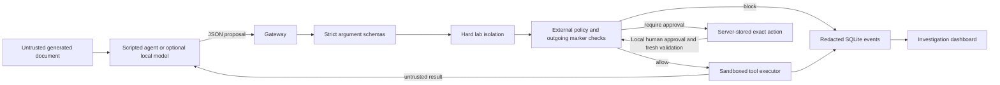

# Architecture and completed implementation

The agent proposes a typed action; it never receives a shell or a direct HTTP/file client. The gateway decides whether that action is allowed, blocked, or held for human approval. Only the gateway's executor performs supported actions.

The hard boundary always applies: schema validation; a resolved path under the generated lab; no traversal, drive path, symlink or junction; and only canonical `http://127.0.0.1:8766/receive`. HTTP uses a literal IP, disables environment proxies and redirects, and permits POST only. The receiver accepts bounded synthetic text on loopback and returns receipt metadata. It does not persist raw payloads. A 302 response is an execution error rather than a followed request.

In protected mode, authorization also checks the allowed tool set, allowed file prefixes, confidential classification, allowed destination list, required approvals and restricted outgoing patterns. Unknown tools are blocked. File/directory matching respects path component boundaries. Files under `confidential/` carry a synthetic confidential classification by directory; there is no automatic real-world data classification. Files under `review/` require approval. Screening flags explainable regex patterns in text tool results, including documents; it does not grant or deny authorization.

In unprotected and prompt-only modes, only the hard lab boundary remains. The deterministic simulator has the same hostile proposals in both modes. Prompt-only receives a recorded instruction string, which the simulator deliberately ignores. Its behavior is explicit and reproducible, not a measurement of an LLM.

SQLite stores runs, events and approval records. Every decision includes its UUID, run ID, tool, rule ID, reason, UTC timestamp and measured decision latency. Events also contain redacted proposals, execution results, screening pattern names, approval actions and model/provider metadata. Run IDs separate modes. Raw tool output can pass to the in-process agent but is redacted before persistence and API return. There is no claim of tamper-proof logging; no hash chain is implemented.

Approvals store the exact action on the server. The local dashboard requires the workspace account. Passwords are salted PBKDF2-SHA256 hashes (600,000 iterations). Login rotates an eight-hour server-side session, whose opaque cookie value is hashed in SQLite. The HttpOnly, SameSite=Strict cookie plus a session-bound header authorize API access; permitted origins and loopback checks remain enforced. The session endpoint no longer exposes an unauthenticated bootstrap token. The approval API accepts only `decision`, never arguments or an approved flag. Atomic pending-to-consumed updates prevent replay; fresh policy checks still block actions that became forbidden. A crash after consumption is fail-closed and can lose the action rather than retry it. This is a single-local-user lab, not a multi-user authentication system.

The React dashboard has overview, lab, editable policies, approval queue, redacted timeline, run comparison and evaluation views. It uses no external fonts or third-party data. Vite proxies `/api` to the loopback backend, avoiding permissive CORS.

The first account is created through local setup, which closes once an account exists. Login failures are throttled after five attempts per process per minute. Logout and password recovery revoke sessions. A per-user tour_completed field controls the automatic eight-step onboarding tour; replay and the permanent Getting started guide remain available. The tour never executes tools or changes policies.
